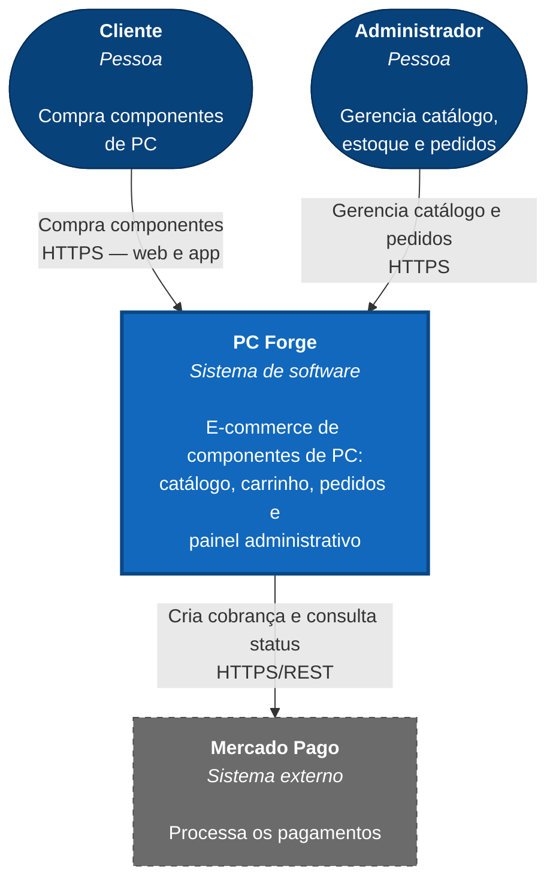
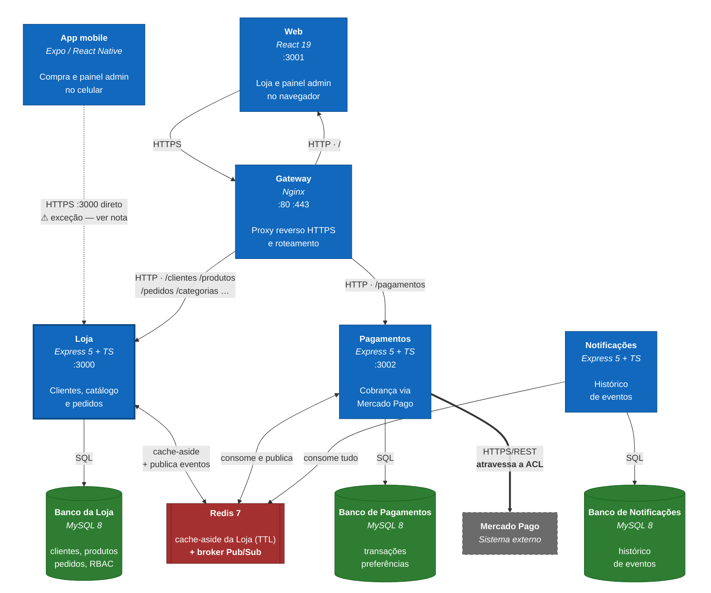
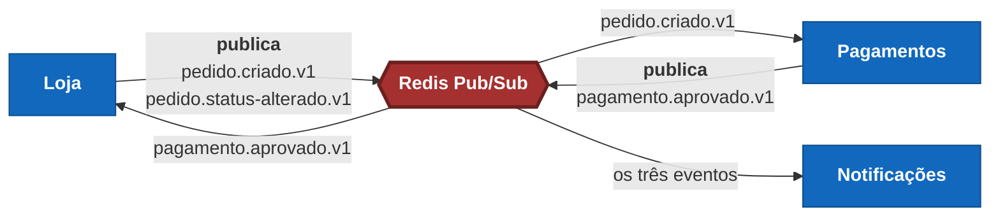

# Arquitetura em C4 — Contexto e Containers

Os dois primeiros níveis do modelo C4 aplicados ao PC Forge. Entrega da SCRUM-28.

O C4 descreve um sistema em níveis de zoom: **Contexto** mostra o sistema inteiro como uma
caixa e quem interage com ele; **Containers** abre essa caixa e mostra as unidades que rodam
separadamente. Cada nível responde a uma pergunta diferente, e misturá-los produz o diagrama
que não serve para ninguém.

Os desenhos vivem em `docs/diagramas/`, no padrão `.drawio.png` definido em
[diagramas/README.md](diagramas/README.md). Este documento é a especificação deles.

---

## Nível 1 — Contexto

**A pergunta:** quem usa o PC Forge e com que sistemas ele conversa?

Neste nível o sistema inteiro é **uma caixa só**. Não aparecem serviços, bancos nem
tecnologia — quem lê é alguém que quer entender o produto, não a implementação.

### Elementos

| Elemento | Tipo | Descrição |
|---|---|---|
| **Cliente** | Pessoa | Navega o catálogo, compra e acompanha os próprios pedidos |
| **Administrador** | Pessoa | Gerencia produtos, categorias, estoque e pedidos |
| **PC Forge** | Sistema (foco) | E-commerce de componentes de PC |
| **Mercado Pago** | Sistema externo | Processa os pagamentos |

### Relações

| De | Para | Rótulo |
|---|---|---|
| Cliente | PC Forge | Compra componentes · HTTPS, web e app |
| Administrador | PC Forge | Gerencia catálogo e pedidos · HTTPS |
| PC Forge | Mercado Pago | Cria cobrança e consulta status · HTTPS/REST |

### O diagrama

As cores seguem a convenção do C4: **azul escuro** para pessoas, **azul vivo** para o sistema
em foco, **cinza tracejado** para sistema externo — o que não é nosso e não controlamos.

Para refazer no draw.io: o PC Forge no centro, as pessoas acima, o Mercado Pago à direita.
Três setas com os rótulos acima. Legenda no canto distinguindo os três tipos.

Arquivo: `docs/diagramas/c4-contexto.drawio.png`

---

## Nível 2 — Containers

**A pergunta:** quais unidades implantáveis existem e como conversam?

Container, no C4, é qualquer coisa que roda separadamente e pode ser implantada sozinha:
aplicação, serviço, banco, broker. **Não é container Docker** — a coincidência de nome
confunde, embora aqui cada container do C4 seja de fato um container Docker.

Levantado do `docker-compose.yml` real.

### Elementos

| Container | Tecnologia | Porta | Responsabilidade |
|---|---|---|---|
| **Web** | React 19 | 3001 | Loja e painel administrativo no navegador |
| **App mobile** | Expo / React Native | — | Compra do cliente e painel do admin |
| **Gateway** | Nginx | 80, 443 | Proxy reverso HTTPS e roteamento entre serviços |
| **Loja** | Express 5 + TypeScript | 3000 | Clientes, catálogo e pedidos — o core domain |
| **Pagamentos** | Express 5 + TypeScript | 3002 | Cobrança via Mercado Pago |
| **Notificações** | Express 5 + TypeScript | — | Consome eventos e guarda o histórico |
| **Banco da Loja** | MySQL 8 | — | Clientes, produtos, pedidos, RBAC |
| **Banco de Pagamentos** | MySQL 8 | — | Transações e preferências |
| **Banco de Notificações** | MySQL 8 | — | Histórico de eventos |
| **Redis** | Redis 7 | — | Cache da Loja **e** broker Pub/Sub |

### Relações

| De | Para | Rótulo |
|---|---|---|
| Web | Gateway | HTTPS |
| App mobile | Loja | HTTPS — hoje direto na porta 3000 ⚠️ |
| Gateway | Web | HTTP, proxy reverso |
| Gateway | Loja | HTTP — `/clientes`, `/produtos`, `/pedidos`, … |
| Gateway | Pagamentos | HTTP — `/pagamentos` |
| Loja | Banco da Loja | SQL/TCP |
| Loja | Redis | Cache-aside (TTL) **e** publica eventos |
| Pagamentos | Banco de Pagamentos | SQL/TCP |
| Pagamentos | Redis | Consome `pedido.criado.v1`, publica `pagamento.aprovado.v1` |
| Pagamentos | Mercado Pago | HTTPS/REST, atravessando a ACL |
| Notificações | Banco de Notificações | SQL/TCP |
| Notificações | Redis | Consome todos os eventos |
| Redis | Loja | Entrega `pagamento.aprovado.v1` |

### O diagrama

**Três cores, três papéis:** azul são aplicações nossas, verde são bancos, vermelho é a
infraestrutura compartilhada. O Mercado Pago em cinza tracejado, porque não é nosso.

**O que o desenho prova sem precisar de legenda:** cada serviço tem um banco e só fala com
ele. Não existe nenhuma seta de serviço para banco de outro serviço, nem de serviço para
serviço — tudo que atravessa fronteira passa pelo Redis. É a regra central do
[ADR-002](adr/002-corte-microsservicos.md), visível de relance.

**A seta tracejada do app mobile é a exceção real**, não um erro do desenho: o celular não
confia no certificado autoassinado do Nginx, então hoje acessa a Loja direto na porta 3000.
A SCRUM-42 resolve. Até lá, o diagrama mostra o que existe.

### Como refazer no draw.io

Quatro faixas horizontais, de cima para baixo:

1. **Clientes** — Web e App mobile
2. **Entrada** — Gateway (Nginx)
3. **Serviços** — Loja, Pagamentos, Notificações lado a lado, **cada um com seu banco logo
   abaixo**. Essa proximidade visual é o que comunica "um banco por serviço" sem precisar de
   legenda.
4. **Infraestrutura compartilhada** — Redis atravessando a largura dos três serviços

O **Mercado Pago** fica fora, à direita, tracejado, ligado só ao Pagamentos.

**Dois tipos de seta, e a distinção é o ponto do diagrama:**

- **Linha cheia** — chamada síncrona (HTTPS, SQL). Quem chama espera a resposta.
- **Linha tracejada** — evento assíncrono via Redis Pub/Sub. Quem publica não espera nem
  sabe quem escuta.

Toda seta tracejada passa pelo Redis. Isso deixa visível que **nenhum serviço chama outro
diretamente** — a regra central da arquitetura, que o [ADR-002](adr/002-corte-microsservicos.md)
estabelece.

A seta do **App mobile direto na Loja** merece destaque em cor de alerta ou uma nota: é a
exceção que ainda existe, porque o celular não confia no certificado autoassinado do Nginx.
A SCRUM-42 resolve isso, e até lá o diagrama deve mostrar a realidade, não a intenção.

Arquivo: `docs/diagramas/c4-containers.drawio.png`

---

## O fluxo dos eventos, em detalhe

O nível 2 mostra *que* os serviços falam por eventos. Este diagrama mostra *quais* eventos, e
em que direção — levantado dos arquivos reais em `src/events/` de cada serviço.

| Serviço | Publica | Consome | Arquivo |
|---|---|---|---|
| **Loja** | `pedido.criado.v1` `pedido.status-alterado.v1` | `pagamento.aprovado.v1` | `events/pedido.event.ts` `events/pagamento-aprovado.subscriber.ts` |
| **Pagamentos** | `pagamento.aprovado.v1` | `pedido.criado.v1` | `events/pagamento-aprovado.event.ts` `events/pedido-criado.consumer.ts` |
| **Notificações** | — | os três | `events/event-types.ts` |

**A Loja é publicadora e assinante ao mesmo tempo**, e é esse ciclo que torna a confirmação
de pagamento assíncrona: ela publica `pedido.criado`, o Pagamentos cobra, publica
`pagamento.aprovado`, e só então a Loja marca o pedido como pago. Foi exatamente essa volta
que motivou dividir a SCRUM-23 em dois cards — publicar não depende de ninguém, consumir
depende do serviço de Pagamentos existir.

**Notificações só escuta.** Não publica nada e ninguém depende dele. É por isso que ele é um
subdomínio *generic* — e é também a prova viva de que as mensagens circulam, que a rubrica
pede.

---

## Uma inconsistência encontrada ao levantar este diagrama

Comparando as rotas que a Loja monta com as que o Nginx encaminha, duas não estão cobertas:

| Rota montada pela Loja | O Nginx encaminha? |
|---|---|
| `/clientes` `/produtos` `/categorias` `/enderecos` `/pedidos` `/itens-pedido` `/upload` | ✅ |
| **`/admin`** (dashboard administrativo) | ❌ cai no frontend |
| **`/uploads`** (imagens servidas estaticamente) | ❌ cai no frontend |

Hoje isso não quebra nada, porque **só o app mobile consome `/admin/dashboard`** e ele acessa
a porta 3000 diretamente, sem passar pelo gateway.

Mas a **SCRUM-42** vai justamente fazer o mobile passar pelo Nginx — e, do jeito que a regex
está hoje (`nginx/nginx.conf:56`), o painel administrativo do app para de funcionar no
momento em que isso acontecer. As duas rotas precisam entrar na lista junto com aquela
mudança.

---

## O que fica para o nível 3

C4 tem ainda Componentes (nível 3) e Código (nível 4). A rubrica pede só Contexto e
Containers, e há uma razão para parar aqui: o nível 3 desatualiza rápido e dá trabalho
contínuo de manutenção. Contexto e Containers mudam pouco — exatamente o que um diagrama
versionado no repositório precisa ser para continuar verdadeiro.

A organização interna de cada serviço está descrita em texto nos ADRs e no
[Context Map](ddd-context-map.md), que é suficiente neste escopo.

---

## Referências

- [Context Map e Bounded Contexts](ddd-context-map.md)
- [Aggregates do contexto Loja](ddd-aggregates.md)
- [ADR-002 — corte em 3 microsserviços](adr/002-corte-microsservicos.md)
- [Contratos dos eventos](contratos-eventos.md)
- BROWN, Simon. *The C4 model for visualising software architecture* — c4model.com
