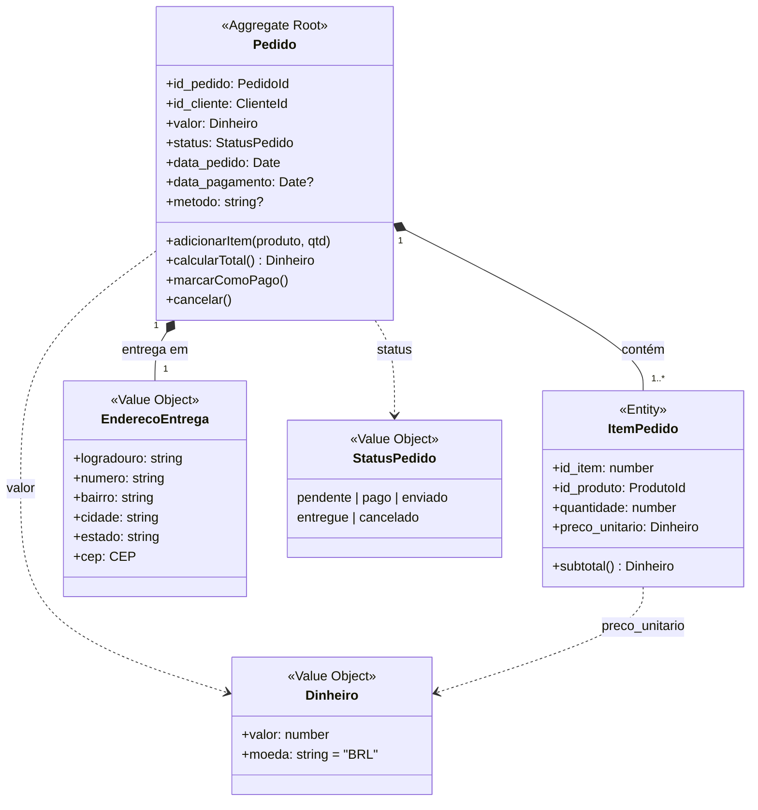
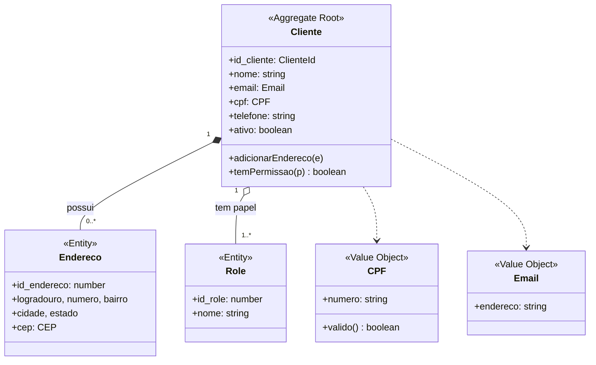
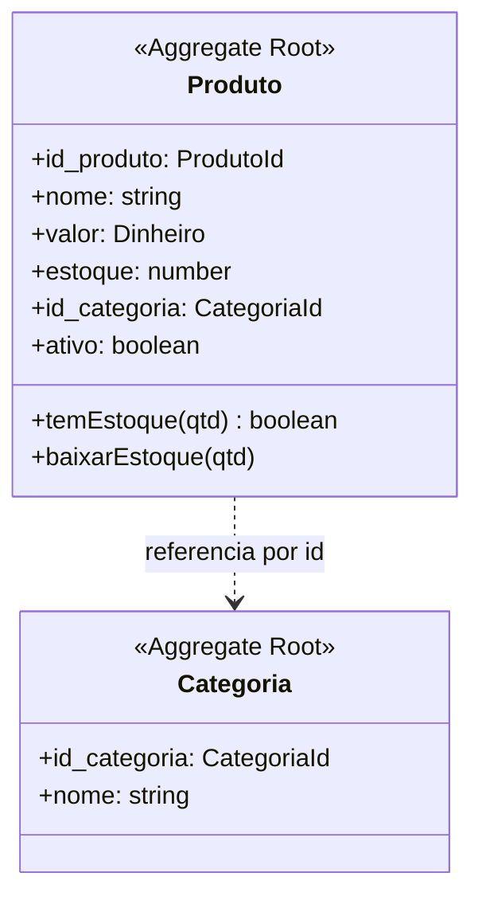

# Entities, Value Objects e Aggregates — contexto Loja

Modelagem tática do DDD aplicada ao contexto **Loja**. Entrega da SCRUM-30.

A Loja foi escolhida por ser o **core domain** — a classificação dos subdomínios está em
[ddd-context-map.md](ddd-context-map.md). Modelar o core com cuidado e os outros com o
mínimo é a consequência prática daquela classificação.

Tudo aqui descreve o código real em `TechAcademy5back/src/models/`.

---

## Os três conceitos

**Entity** tem identidade própria que persiste mesmo quando os atributos mudam. Um cliente
que troca de e-mail continua o mesmo cliente, porque `id_cliente` não mudou.

**Value Object** não tem identidade: vale pelo que é. Dois CEPs "01310-100" são o mesmo CEP,
e não faz sentido perguntar "qual deles". São imutáveis — mudar um valor é criar outro.

**Aggregate** é um grupo de entities e value objects tratado como uma unidade, com uma
**raiz** que é a única porta de entrada. A fronteira do aggregate é a fronteira de uma
transação: tudo dentro dele fica consistente de uma vez.

---

## Aggregate Pedido

O mais importante do sistema, e o que o [ADR-002](adr/002-corte-microsservicos.md) usa para
justificar o corte dos microsserviços.

**A raiz é `Pedido`.** Nada acessa um `ItemPedido` diretamente: para alterar um item,
passa-se pelo pedido. Isso não é formalidade — é o que garante que o total e os itens nunca
fiquem inconsistentes.

**A fronteira é a transação.** Em
[`pedido.service.ts`](../TechAcademy5back/src/services/pedido.service.ts), a transação abre
na linha 179, cria pedido e itens, baixa o estoque com `Produto.decrement` na linha 210 e faz
commit na 217. Se qualquer item falhar, o rollback desfaz tudo junto. A fronteira do
aggregate e a fronteira da transação são a mesma linha.

### Por que `preco_unitario` fica no item, e não no produto

É a decisão de modelagem mais reveladora deste aggregate.

O preço do produto muda com o tempo. Se o item apontasse para o preço atual do produto, um
pedido de três meses atrás mudaria de valor sozinho quando alguém editasse o catálogo — e o
histórico de vendas viraria ficção.

`preco_unitario` é um **snapshot**: o preço no momento em que a compra aconteceu. Ele
pertence ao pedido, não ao produto. Pela mesma razão, `EnderecoEntrega` deveria ser uma cópia
imutável dentro do pedido, e não uma referência ao endereço do cliente — hoje o código guarda
`id_endereco_entrega` como referência, o que significa que **editar o endereço muda para onde
um pedido antigo foi entregue**. É uma divergência conhecida entre o modelo ideal e o código
atual, registrada aqui de propósito.

---

## Aggregate Cliente

`Endereco` é **composição** — não existe endereço sem cliente. `Role` é **agregação**: os
papéis existem independentemente e são compartilhados entre clientes, então o Cliente os
referencia, mas não os contém.

`CPF` e `Email` são value objects naturais: a validação que hoje vive em
[`cliente.validation.ts`](../TechAcademy5back/src/utils/cliente.validation.ts) pertence
conceitualmente a eles — um CPF inválido não deveria sequer poder existir como objeto.

---

## Aggregate Produto

**`Categoria` é raiz de um aggregate próprio, e `Produto` a referencia por `id`, não por
objeto.** Essa é a regra mais fácil de violar com um ORM: o Sequelize permite
`produto.categoria.nome` com um `include`, e de repente dois aggregates estão carregados
juntos como se fossem um. Referência entre aggregates diferentes é sempre **por identidade**.

---

## As regras que o desenho impõe

**Uma transação altera um aggregate só.** A exceção deliberada do projeto é a baixa de
estoque: `Pedido` e `Produto` são aggregates distintos alterados na mesma transação. Foi uma
escolha consciente — a alternativa correta pelo livro seria consistência eventual entre os
dois, com uma saga, e o [ADR-002](adr/002-corte-microsservicos.md) explica por que o custo
não se paga neste escopo.

**Referência entre aggregates é por id.** `ItemPedido` guarda `id_produto`, não o objeto
`Produto`.

**Aggregates pequenos.** `Cliente` não contém seus pedidos: seriam centenas de objetos
carregados para responder "qual o nome deste cliente". Pedido referencia cliente por id, e
pronto.

---

## Relação com os eventos

Aggregate é também a unidade natural de publicação: `pedido.criado.v1` é publicado quando o
**Aggregate Pedido** termina de ser criado, com os dados que outro contexto precisa — nunca
com o aggregate inteiro. O contrato está em [contratos-eventos.md](contratos-eventos.md).

É por isso que o payload do evento não carrega estoque nem categoria: o contexto de
Pagamentos não tem o que fazer com eles.

---

## Referências

- [Context Map e Bounded Contexts](ddd-context-map.md)
- [ADR-002 — corte em 3 microsserviços](adr/002-corte-microsservicos.md)
- EVANS, Eric. *Domain-Driven Design*, parte II — Building Blocks
- VERNON, Vaughn. *Effective Aggregate Design*
