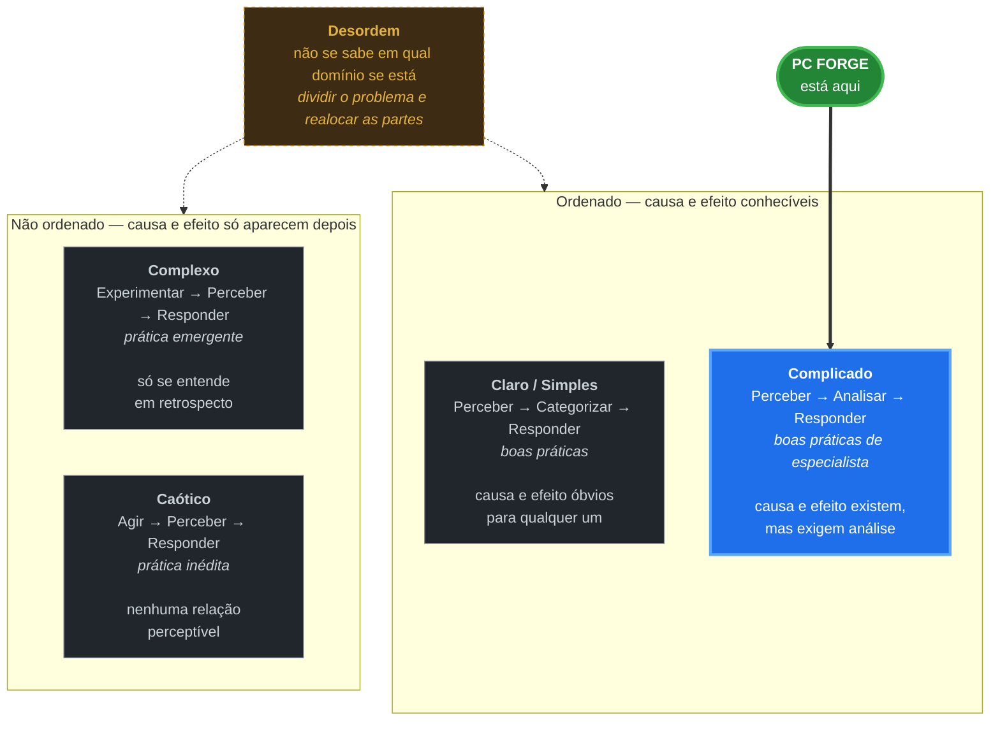

# Análise Cynefin e escolha da abordagem

Em qual domínio o PC Forge se encaixa e o que isso determina sobre como o projeto é
conduzido. Entrega da SCRUM-14.

## O framework

Cynefin, de Dave Snowden, classifica uma situação pela **relação entre causa e efeito** — o
que se pode saber antes de agir. Cada domínio pede uma sequência de ação diferente, e aplicar
a sequência do domínio errado é a principal forma de errar com ele.

**Desordem** é o quinto domínio e o mais perigoso: é o estado de não saber em qual dos
outros quatro se está. Quem cai nele tende a agir pelo domínio em que se sente mais
confortável, e não pelo que a situação exige. A saída é quebrar o problema em partes e
alocar cada uma no domínio certo — foi o que este documento fez ao separar o projeto como um
todo (Complicado) da mensageria, que localmente toca o Complexo.

## Onde o PC Forge se encaixa: Complicado

**Os requisitos são conhecidos e estáveis.** A rubrica lista o que precisa existir, com
pontuação item a item e data de entrega. Não há descoberta de produto, não há usuário real
cujo comportamento possa surpreender, não há concorrente mudando o escopo no meio.

**A solução exige especialista, mas não é inédita.** Decompor um monólito, cache-aside com
TTL e invalidação, Pub/Sub, circuit breaker, C4, DDD tático — nada disso é novo. Tudo tem
literatura consolidada, padrão documentado e caminho conhecido. É preciso **analisar** para
escolher entre alternativas (foi o que o [ADR-002](../adr/002-corte-microsservicos.md)
fez ao decidir onde cortar), mas a análise chega a uma resposta defensável antes de executar.

É isso que separa Complicado de Complexo: aqui a análise **antecede** a ação com proveito.

### Por que não os outros domínios

**Não é Simples.** Se fosse, qualquer pessoa aplicaria a solução óbvia sem análise. Não é o
caso — a decisão de manter o Catálogo dentro da Loja exigiu examinar a transação de estoque
em `pedido.service.ts` e concluir que separá-lo obrigaria a uma saga. Duas pessoas diferentes
poderiam cortar o sistema de formas diferentes, e as duas teriam argumento.

**Não é Complexo.** No domínio Complexo só se descobre o que funciona depois de experimentar,
porque o sistema reage de modo imprevisível. Não é o nosso caso: ninguém precisa rodar um
experimento para saber se o Redis serve de cache. O risco aqui é de **execução** — tempo,
aprendizado da dupla —, não de **incerteza sobre a solução**. Confundir os dois é o erro
clássico ao aplicar Cynefin: tratar como Complexo o que é apenas difícil.

**Não é Caótico.** Não há crise, não há sistema fora do ar, não há necessidade de agir antes
de entender.

### A ressalva honesta

Partes isoladas tocam o Complexo. Nenhum dos dois integrantes já operou mensageria entre
serviços, e a primeira tentativa de fazer o evento circular provavelmente vai revelar coisas
que nenhuma análise prévia anteciparia. Isso é local e esperado: a resposta é um *spike*
curto — experimentar com o Pub/Sub num caso mínimo antes de desenhar os contratos
definitivos — sem mudar a classificação do projeto como um todo.

## O que isso determina: abordagem híbrida

Complicado admite planejamento antecipado, porque o escopo não muda. Mas a execução passa por
aprendizado real, e isso pede ciclos curtos com correção de rota.

| Dimensão | Escolha | Por quê |
|---|---|---|
| Escopo | **preditivo** | A rubrica define o que entregar. Não muda. |
| Marcos | **preditivo** | A entrega é 17/11. Não negociável. |
| Execução | **ágil** | Sprints de 2 semanas, backlog priorizado, board |
| Estimativa | **ágil** | Story points por complexidade relativa |
| Documentação | **preditivo** | ADRs, C4, PM Canvas — exigidos como entregáveis |

Na prática: **plano fixo no destino, flexível no caminho.** O PM Canvas e os marcos vêm do
lado preditivo; o board, o backlog estimado e as sprints vêm do lado ágil.

Puramente preditivo falharia porque a dupla ainda está aprendendo as tecnologias — um
cronograma detalhado até novembro estaria errado na primeira semana. Puramente ágil
falharia porque o escopo não é negociável com o cliente: "não deu tempo do circuit breaker"
não reduz a rubrica.

## Referências

- SNOWDEN, D.; BOONE, M. *A Leader's Framework for Decision Making*. Harvard Business
  Review, nov. 2007.
- [PM Canvas do projeto](pm-canvas.md) — o plano que esta classificação justifica
- [Fluxo de trabalho e DoD](fluxo-de-trabalho.md) — a execução ágil na prática
