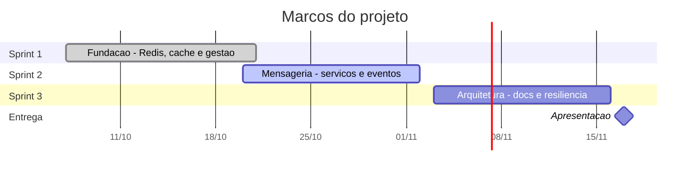

# PM Canvas — PC Forge, módulo de Microsserviços

Plano do projeto em uma página, no modelo PM Canvas de José Finocchio Júnior. Entrega da
SCRUM-15.

A abordagem que este plano assume — escopo e marcos fixos, execução em sprints — vem da
classificação do projeto como **Complicado** em [cynefin.md](cynefin.md).

---

## Por quê

### Justificativas

- O PC Forge existe como **monólito** entregue e funcionando (tag `v1.0.0`): API Express,
  web React, app Expo, 147 testes automatizados. O sistema funciona, mas é uma única unidade
  de implantação — qualquer mudança exige subir tudo.
- O módulo acadêmico de Microsserviços exige demonstrar **decomposição com bancos separados**,
  cache distribuído, mensageria e documentação arquitetural.
- A base existente é vantagem: há domínio real, dados reais e um caso de integração externa
  (Mercado Pago) que justifica resiliência de verdade, em vez de exemplo inventado.

### Objetivos SMART

1. Decompor em **3 serviços com bancos separados** até 02/11, sem perder funcionalidade do
   monólito.
2. **Cache distribuído com Redis** nas consultas frequentes, com TTL e invalidação — ✅
   concluído na Sprint 1.
3. **Mensageria via Redis Pub/Sub** com logs comprovando a circulação, até 02/11.
4. **Documentação arquitetural completa** — C4, ADRs, Context Map, Quality Scenarios,
   OpenAPI, SLOs — até 16/11.
5. **9,0 pontos** na rubrica, com entrega em **17/11/2026**.

### Benefícios

- Serviços com ciclo de implantação independente
- Resiliência isolada: falha do Mercado Pago não derruba a loja
- Evidência prática de arquitetura para o portfólio dos dois
- Decisões registradas em ADR, defensáveis na apresentação

---

## O quê

### Produto

E-commerce de componentes de PC em arquitetura de microsserviços:

| Entrega | Conteúdo |
|---|---|
| **3 serviços** | Loja (clientes, catálogo, pedidos) · Pagamentos (Mercado Pago) · Notificações (eventos) |
| **Infraestrutura** | Docker Compose, Nginx como gateway, Redis (cache + broker), um banco por serviço |
| **Documentação** | C4, ADRs, Context Map, OpenAPI, SLOs/SLIs, runbook |
| **Gestão** | Jira com histórico, Cynefin, PM Canvas, backlog estimado |

O recorte dos serviços e sua justificativa estão no
[ADR-002](../adr/002-corte-microsservicos.md).

### Requisitos

- Nenhum serviço consulta o banco de outro — comunicação só por evento
- JWT emitido pela Loja, validado localmente por cada serviço
- Nginx como única porta exposta
- Queda do Redis não derruba leituras: a Loja continua lendo do MySQL
- Código, comentários e commits em português
- Todo diagrama versionado no repositório

### Stakeholders

| Quem | Interesse |
|---|---|
| Professor avaliador | Rubrica cumprida e decisões defendidas |
| João Vitor | Gestão, documentação e arquitetura; aprendizado dos conceitos |
| Henrique Hoffmann | Back-end, infraestrutura e implementação dos serviços |

---

## Como

### Premissas

- A dupla segue disponível nas 6 semanas, em paralelo com as outras disciplinas
- A conta sandbox do Mercado Pago continua funcionando
- O ambiente roda localmente via Docker Compose, sem nuvem paga
- O monólito atual é base estável: 147 testes passando e CI verde

### Grupo de entregas

| Sprint | Período | Entrega |
|---|---|---|
| **1 — Fundação** | 07/10 – 21/10 | Jira e gestão; Redis com cache-aside; DTOs e erros centralizados |
| **2 — Mensageria** | 20/10 – 02/11 | Extrair Pagamentos e Notificações; eventos; gateway; C4 e Context Map |
| **3 — Arquitetura** | 03/11 – 16/11 | Aggregates, ADRs, Quality Scenarios, OpenAPI, SLOs, resiliência, blue/green, runbook |
| **Entrega** | 17/11 | Apresentação |

### Restrições

- **Data de entrega inegociável:** 17/11/2026
- Equipe de duas pessoas, sem dedicação integral
- Sem orçamento: só ferramentas gratuitas
- Ambiente local — sem cluster, sem Kubernetes
- Escopo definido por rubrica: não há negociação de corte

### Riscos

| Risco | Impacto | Resposta |
|---|---|---|
| Mensageria é inédita para a dupla | Alto | Spike curto na Sprint 2 antes dos contratos definitivos |
| Extrair Pagamentos torna a confirmação assíncrona e quebra o front | Alto | Previsto no ADR-002; tratar "processando" como estado normal na tela de retorno |
| Pub/Sub perde evento se o Redis cair | Médio | Limitação registrada no ADR-001; outbox fica fora do escopo acadêmico |
| Sobreposição com outras disciplinas | Médio | Sprints de 2 semanas com folga; priorizar o que vale ponto |
| Três bancos consumindo RAM na máquina local | Médio | PostgreSQL nos serviços pequenos; subir só o necessário |
| Trabalho entrando sem revisão | Médio | DoD e fluxo de PR definidos na SCRUM-13, valendo da Sprint 2 |

### Equipe

Dupla, sem hierarquia formal. **João Vitor**: gestão, Jira, documentação, arquitetura.
**Henrique Hoffmann**: back-end, infraestrutura, serviços. Arquitetura e apresentação a dois.

### Linha do tempo

### Custos

Financeiro: **R$ 0,00**. Docker, Redis, PostgreSQL, Nginx e GitHub Actions em repositório
público são gratuitos; o Mercado Pago roda em sandbox; o Jira usa o plano free.

Esforço estimado: ~6 semanas × 2 pessoas, em dedicação parcial.
